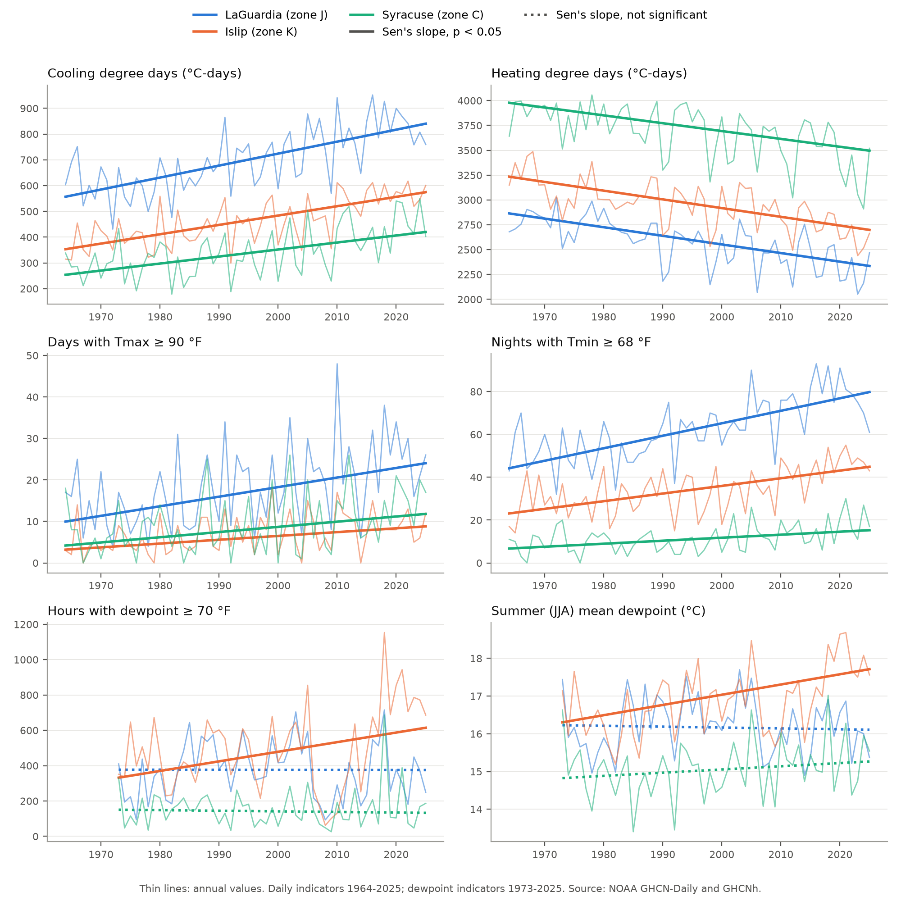
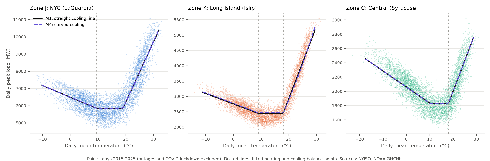
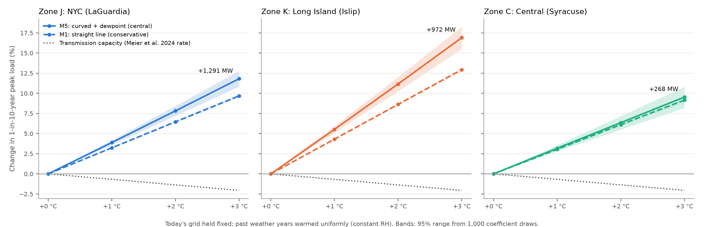
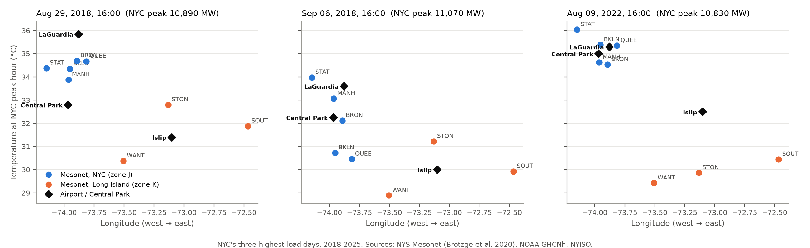

# Climate-Driven Temperature and Humidity Effects on New York State Electricity Demand

EN.530.637 Energy Meteorology, Johns Hopkins University, Fall 2026 — graduate semester project
Author: Alex Colletti

This project measures how much New York's electricity demand depends on temperature and
humidity, how the weather that drives demand has changed since the mid-20th century, and how
much peak demand would rise with further warming. It combines hourly NYISO zonal load with
NOAA airport weather records (1950–2025) and the NYS Mesonet (2016–2025) for three contrasting
load zones: **J (New York City)**, **K (Long Island)**, and **C (Central New York)**, which
together use about 56% of the state's electricity (2015–2025).

## Research questions
1. How have the weather drivers of electricity load (cooling/heating degree days, hot days, warm nights, humid hours) changed since the mid-20th century?
2. How sensitive is daily peak load to temperature and humidity in zones J, K, and C, and does adding humidity improve load models?
3. Holding today's grid fixed, how much would peak load rise under +1 to +3 °C of additional warming?

## Key results

**1. Cooling demand is rising and heating demand is falling at all six stations** (Mann–Kendall trend tests, Sen's slope per decade, 1964–2025, all p < 0.05). At LaGuardia, cooling degree days rose by 46 °C-days per decade, and nights with a minimum of at least 68 °F went from about 52 to 80 per year (1964–73 vs. 2016–25 averages). Summer dewpoint shows no significant trend at LaGuardia, Central Park, or Syracuse.



**2. Peak load rises steeply above a cooling balance point of about 18–19 °C (64–66 °F).** Sustained cooling sensitivity (model M1, 2015–2025, 95% CI): NYC 350 MW/°C (336–363), Long Island 237 MW/°C (230–243), Central 86 MW/°C (82–89), which is 4.3%, 6.2%, and 4.0% of the summer peak per °C. Heating sensitivity is only about 1% of the winter peak per °C because most New York heating is not electric. Adding dewpoint (M2) cuts NYC's out-of-sample error on its top 5% load days by about 11% (RMSE 883 → 786 MW).



**3. With today's grid, +3 °C raises the 1-in-10-year peak (model M5) by about 12% in NYC (+1,290 MW), 17% on Long Island (+970 MW), and 10% in Central NY (+270 MW)**, and today's 1-in-10-year peak would be exceeded on about 3–4 days per year (2.7 on Long Island to 4.2 in Central NY), up from about 0.1 today. Over the same warming, transmission capacity falls about 2% (rate from Meier et al. 2024).



**Robustness and data quality.** Cooling sensitivities estimated with NYS Mesonet zone averages agree with the airport-based estimates within about 5% in all three zones (model M1); Central NY's humidity term is not robust to the choice of stations. On NYC's three highest-load days of 2018–2025, temperatures across NYC and Long Island stations differed by 5–7 °C at the peak hour (below). Islip's dewpoint shifted by about 1 °C relative to Central Park after 2012 while LaGuardia's did not, so Islip's rising humidity trend is not interpreted as climate change (`figures/dewpoint_check.png`).



Other figures: `model_comparison.png` (out-of-sample accuracy of models M1–M5), `sensitivity_over_time.png` (NYC's cooling sensitivity rose from 3.8% to 4.7% of the summer peak per °C between the 2005–09 and 2021–25 windows), `peak_frequency.png`, `mesonet_comparison.png`, `dewpoint_check.png`.

## Data: where to get it

No data files are stored in this repository: the raw data total about 15 GB, and the NYS Mesonet
data may not be redistributed. Three sources download automatically with the scripts; the
Mesonet must be requested.

### 1. NYISO hourly load (automatic)
- **Dataset:** P-58C "Integrated Real-Time Actual Load", hourly average load (MW) for the 11 NYISO zones, hour-beginning Eastern time: <https://mis.nyiso.com/public/P-58Clist.htm>
- **Period:** June 2001 (start of the archive) – December 2025
- **Get it:** `python scripts/download_nyiso.py` downloads the monthly zip archives (`https://mis.nyiso.com/public/csv/palIntegrated/YYYYMM01palIntegrated_csv.zip`) to `data/raw/nyiso/`. About 150 MB, a few minutes.

### 2. NOAA hourly weather, GHCNh (automatic)
- **Dataset:** Global Historical Climatology Network – hourly (GHCNh), the successor to NOAA's Integrated Surface Database: <https://www.ncei.noaa.gov/products/global-historical-climatology-network-hourly>
- **Variables:** temperature, dewpoint, relative humidity (°C, UTC); **period:** 1973–2025
- **Get it:** `python scripts/download_noaa.py` downloads one file per station per year from `https://www.ncei.noaa.gov/oa/global-historical-climatology-network/hourly/access/by-year/{YEAR}/psv/GHCNh_{STATION}_{YEAR}.psv` to `data/raw/ghcnh/`. About 3 GB, 30–60 minutes. Re-running skips files already downloaded. Central Park has no hourly files for 1983 and 1985–1994; this is expected.

| Station | GHCN ID | Role |
|---|---|---|
| LaGuardia Airport | USW00014732 | Zone J (NYC) weather |
| Islip MacArthur Airport | USW00004781 | Zone K (Long Island) weather |
| Syracuse Hancock Airport | USW00014771 | Zone C (Central) weather |
| Central Park | USW00094728 | Long daily record; reference station |
| Buffalo Niagara Airport | USW00014733 | Upstate reference |
| Albany Airport | USW00014735 | Upstate reference |

### 3. NOAA daily temperature, GHCN-Daily (automatic)
- **Dataset:** GHCN-Daily daily maximum/minimum temperature (Menne et al. 2012), via NOAA's data service: <https://www.ncei.noaa.gov/access/services/data/v1?dataset=daily-summaries&stations=USW00094728&startDate=1950-01-01&endDate=2025-12-31&dataTypes=TMAX,TMIN&units=standard&format=csv> (change the station ID)
- **Period:** 1950–2025 (Islip from September 1963)
- **Get it:** downloaded by `python scripts/download_noaa.py` to `data/raw/ghcnd/`.

### 4. NYS Mesonet (request required)
- **Dataset:** NYS Mesonet Standard Network, 5-minute observations from about 127 stations (Brotzge et al. 2020): <https://nysmesonet.org>
- **Request it** at <https://nysmesonet.org/weather/requestdata> with these settings: category *Academic/Research*; network *Standard*; all stations; variables: latitude/longitude/elevation, air temperature at 2 m, relative humidity at 2 m, dewpoint at 2 m (and optionally solar radiation and best-available wind at 10 m); metric units; UTC; CSV; **one file per station**; earliest available date through 2025-12-31. Access terms (including any cost-recovery fee) are set by the NYS Mesonet Data Access Policy at <https://nysmesonet.org/about/data>; users must agree to the Data Policy and Terms of Use, and redistribution of the data is not allowed. The delivery used here was 5-minute data through 2026-11-03 (about 12 GB); `clean_mesonet.py` averages it to hourly values and cuts it at 2025-12-31.
- **Place the files** (e.g. `BKLN.csv`, `MANH.csv`, …) in `data/raw/nysm/`.
- Mesonet data are used only from `clean_mesonet.py` onward; everything except `check_dewpoint.py` panel (c) and `mesonet_comparison.py` runs without them.

## Running the code

**Requirements:** Python 3.11 (tested on Windows 11) and the packages in `requirements.txt`
(pandas, numpy, requests, pyarrow, matplotlib, statsmodels, scipy, pymannkendall, metpy, ipykernel).

```bash
git clone https://github.com/alexcolletti55/nys-climate-load.git
cd nys-climate-load
python -m venv .venv
source .venv/bin/activate          # Windows: .venv\Scripts\activate
pip install -r requirements.txt
```

Run every script from the repository root, in this order. Each script only reads the output
of earlier steps, so any step can be re-run on its own.

| Step | Command | Reads | Writes | Time* |
|---|---|---|---|---|
| Download | `python scripts/download_nyiso.py` | NYISO website | `data/raw/nyiso/` | ~5 min |
| Download | `python scripts/download_noaa.py` | NOAA website | `data/raw/ghcnh/`, `data/raw/ghcnd/` | 30–60 min |
| Clean | `python scripts/build_nyiso_hourly.py` | `data/raw/nyiso/` | `data/cleaned/nyiso_hourly_load.parquet` (+ log of removed values) | ~3 min |
| Clean | `python scripts/clean_weather.py` | `data/raw/ghcnh/`, `ghcnd/` | `data/cleaned/weather_hourly.parquet`, `weather_daily.parquet` | ~10 min |
| Clean | `python scripts/clean_mesonet.py` | `data/raw/nysm/` | `data/cleaned/mesonet_hourly/`, `mesonet_stations.csv` | ~15 min |
| Merge | `python scripts/build_zone_daily.py` | `data/cleaned/` | `data/processed/zone_daily.parquet` (+ `.csv`), `zone_hourly.parquet` | ~1 min |
| RQ 1 | `python scripts/climate_trends.py` | `data/cleaned/` | `results/climate_*.csv`, `figures/climate_trends.png` | <1 min |
| Data check | `python scripts/check_dewpoint.py` | `data/cleaned/` | `results/dewpoint_check_*.csv`, `figures/dewpoint_check.png` | <1 min |
| RQ 2 | `python scripts/load_model.py` | `data/processed/` | `results/load_model_*.csv`, `load_sensitivity_over_time.csv`, 3 figures | ~1 min |
| RQ 3 | `python scripts/projections.py` | `data/processed/` | `results/projections_summary.csv`, 2 figures | <1 min |
| Robustness | `python scripts/mesonet_comparison.py` | `data/processed/`, `data/cleaned/` | `results/mesonet_*.csv`, 2 figures | ~1 min |

\*Approximate times on a laptop.

## Methods in brief
- **Cleaning:** NOAA quality codes plus physical limits (e.g., dewpoint ≤ temperature); one weather report per hour; NYISO impossible spikes and dropouts removed and logged; all times converted to UTC; outages (2003 blackout, Hurricane Irene, Superstorm Sandy) and the spring-2020 COVID lockdown are **flagged**, not deleted, and left out of model fitting.
- **Load–weather matching:** NYISO hour-beginning load is paired with the average of the weather observations at the start and end of the hour; daily values use local calendar days.
- **RQ 1:** annual climate indicators; Mann–Kendall trend test with Sen's slope.
- **RQ 2:** daily peak load regressed (ordinary least squares) on piecewise-linear and quadratic temperature terms around heating and cooling balance points chosen by grid search, yesterday's temperature, dewpoint (M2, M5) or heat index (M3), and calendar effects; Newey–West standard errors; out-of-sample test with training on 2015–2021 and testing on 2022–2025.
- **RQ 3:** delta method. Past weather years are warmed uniformly at constant relative humidity and run through models M5 (central) and M1 (conservative) with today's grid held fixed; uncertainty comes from 1,000 coefficient draws.

**Limitations:** one airport station represents each zone (tested against Mesonet zone averages); zone C's Mesonet station set approximates the zone; post-COVID changes in NYC demand affect out-of-sample accuracy; projections assume uniform warming and today's technology. In particular, they do not include building electrification, which is expected to make New York's demand peak in winter.

## Repository layout
```
scripts/          download, cleaning, merge, and analysis scripts
results/          results tables (CSV) derived from public data
figures/          figures for the paper and presentation
data/             NOT in the repository; created by the scripts:
  raw/            downloads exactly as received (never edited)
  cleaned/        one tidy table per source
  processed/      load and weather merged for analysis
```

## Acknowledgments and data citations
This research is made possible by the New York State (NYS) Mesonet. Original funding for the NYS Mesonet (NYSM) buildup was provided by Federal Emergency Management Agency grant FEMA-4085-DR-NY. The continued operation and maintenance of the NYSM is supported by National Mesonet Program, University at Albany, Federal and private grants, and others.

- Brotzge, J. A., and Coauthors, 2020: A technical overview of the New York State Mesonet standard network. *J. Atmos. Oceanic Technol.*, **37**, 1827–1845, https://doi.org/10.1175/JTECH-D-19-0220.1.
- Menne, M. J., I. Durre, R. S. Vose, B. E. Gleason, and T. G. Houston, 2012: An overview of the Global Historical Climatology Network-Daily database. *J. Atmos. Oceanic Technol.*, **29**, 897–910, https://doi.org/10.1175/JTECH-D-11-00103.1.
- NOAA National Centers for Environmental Information: Global Historical Climatology Network – hourly (GHCNh).
- New York Independent System Operator (NYISO): Integrated Real-Time Actual Load (P-58C).
- Meier, S., and Coauthors, 2024: New York State Climate Impacts Assessment Chapter 06: Energy. *Ann. N. Y. Acad. Sci.*, **1542**, 341–384, https://doi.org/10.1111/nyas.15191.
